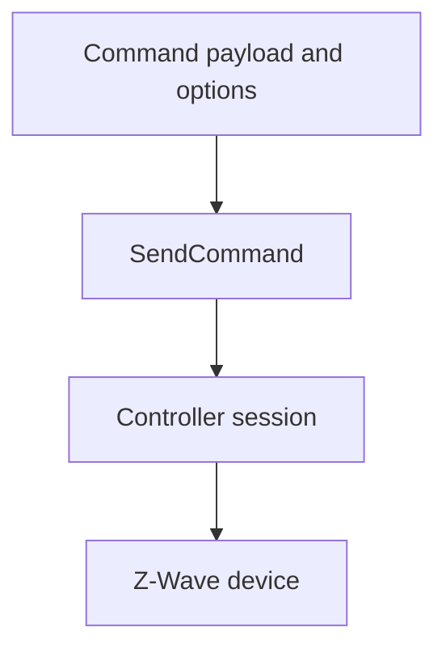
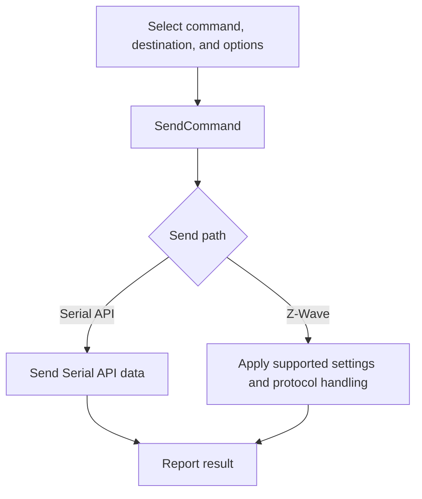
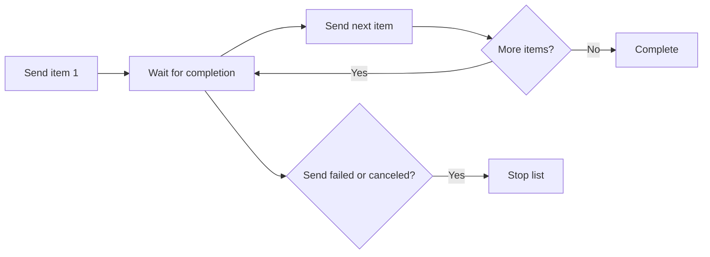
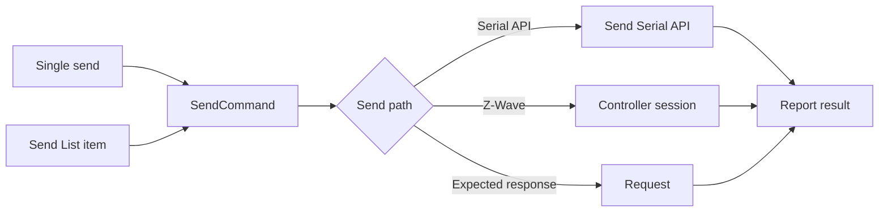

# Send Data and Send List

This guide describes how the Command Classes view sends one command and how Predefined Commands sends an ordered group.

## Send pipeline

The command payload and selected options pass through the controller session, which applies the protocol handling supported by the active send path.

Options may add protocol encapsulation or change routing/security behavior. Transport may split a large message into multiple radio frames. One **Send** action is one command operation, not necessarily one radio frame.

## Send one command

1. Select the destination node.
2. Choose a Command Class and command, or enter/select the payload.
3. Set any options you need, such as security, Supervision, Multi-Channel endpoints, or CRC16.
4. Choose **Send**. If **Expect command** is selected, the button acts as a request and waits for the expected response.

### Send behavior

- Requires a payload and selected node.
- Uses the Serial API path when **Serial API** is selected.
- Otherwise sends the payload and selected settings through the controller session. The active path applies supported protocol handling.
- Adds the original command and options to sender history.
- Reports success or failure. An active send can be canceled.

### Send settings

| Setting | What it adds or changes |
|---|---|
| Security | Selects the secure or non-secure send behavior. |
| Supervision | Wraps the command in Supervision Get; the configured session ID and status-update option are used. Auto-increment advances the session ID before sending. |
| Multi-Channel | Adds the selected source/destination endpoint information. A selected endpoint on the target also supplies the destination endpoint. |
| CRC16 | Wraps the command with a CRC16 checksum. |
| Expect command | Sends as a request and waits up to the configured response timeout for the selected response. |

## Send a group (Send List)

A predefined group is a saved, ordered list of command payloads. **Send List** sends each item by calling the same single-command `SendCommand` path; there is no second frame-sending implementation for list items.

1. Open **Predefined Commands** from the Command Classes view.
2. Create or select a group.
3. Add commands to the group. Use the move buttons to set their order, and save the group if you want to keep it.
4. Select the destination node and the group to send.
5. Choose **Send List**. The list status is shown in the Predefined Commands window; choose **Cancel** to stop it.

### List behavior

| Event | What happens |
|---|---|
| Start | The selected group is read in item-ID order. A second list run is not started while one is already running. |
| Each item | The saved payload and its options are loaded into the command model and sent through `SendCommand`. The next item waits until the current send completes. |
| Successful item | Wait the configured response delay, then continue. |
| Failed item | Stop the list; later items are not sent. The status shows the failure. |
| Cancel | Cancel the active send (if any), stop before the next item, restore the original command model, and show **Stopped**. |
| Finish | Restore the original command model and show **Completed**. |

A list item does not wait for an expected command response: the list runner disables **Expect command** for each item so it can reliably wait for the send operation to finish and proceed.

## Refactoring overview

### What changed

Single sends and Send List items now use the same `SendCommand`. The list service controls order and cancellation; it does not build or send frames itself.

### Why

Previously, separate send paths risked duplicating payload handling and settings behavior. Sharing the single-send command keeps validation, send options, result reporting, and cancellation behavior in one place. The group runner adds only sequencing.

### How it works

- **`SendCommand`** validates the payload, applies the selected send settings, chooses the send/request path, and publishes the result. It uses the controller session's send operations and shared protocol encapsulation helpers where needed.
- **`PredefinedPayloadsService`** orders the saved items, loads each item's payload and options into the command model, invokes `SendCommand`, and waits for completion before continuing.
- **The controller session and protocol managers** perform the transport and protocol handling supported by that session.
- **`CommandClassesViewModel`** remains the editable UI model for the payload and options.

### User-visible impact

- A single send continues to use the selected settings and reports its result through the existing UI and log.
- Send List sends items in order through the same command path. It waits for each send, applies the configured delay after a successful item, and stops on a failure or cancellation; later items are not sent.
- Send List disables **Expect command** per item, restores the user's original command model when it finishes or stops, and can cancel the active send.
- The group runner does not add a second frame-sending implementation. One send operation may still produce multiple radio frames depending on transport and payload size.
